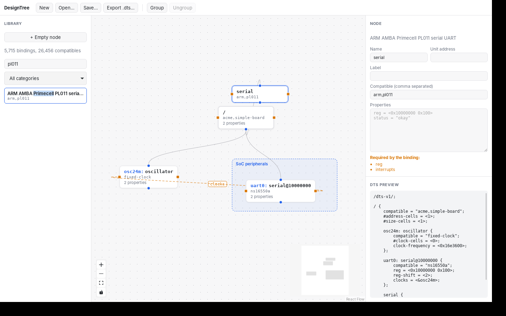

# DesignTree

A graphical editor for Linux devicetrees. Instead of writing `.dts` files by
hand, you place nodes on a canvas, wire them together and group them, in the
style of node editors such as n8n or Simulink. The element library is built
directly from the binding schemas in the Linux kernel source tree
(`Documentation/devicetree/bindings`).

> Status: early skeleton. The Rust backend (model, validation, DTS export,
> binding indexer) and a first desktop app (Tauri 2 + React Flow) work
> end to end.



## Concepts

| Canvas element | Devicetree meaning |
| --- | --- |
| Node | A devicetree node (`serial@10000000`) with compatible strings and properties |
| Child edge | Parent/child relation in the tree |
| Reference edge | A phandle property (`clocks = <&osc24m>;`) |
| Group | Visual grouping only, like a Simulink subsystem; no effect on output |

## Repository layout

```
crates/
  designtree-core/      graph model, validation, DTS generation
  designtree-bindings/  indexer for the kernel binding schemas (element library)
  designtree-cli/       `designtree` command-line tool
app/                    desktop app: Tauri shell (src-tauri/) + React Flow canvas (src/)
examples/               sample design files
docs/                   architecture notes, GUI options, product backlog
```

## Desktop app

```sh
cd app
npm install
npm run tauri dev
# optional: index a kernel tree at startup and open a design
DESIGNTREE_LINUX_SRC=/path/to/linux npm run tauri dev -- -- "$PWD/../examples/simple-board.json"
```

See [app/README.md](app/README.md) for prerequisites and canvas conventions.

## Command line

```sh
# Generate DTS from a sample design. A design imported from a board file is
# written back as a board file: its includes, then only the board's changes
# as &label { } overrides (--flatten writes the whole tree instead).
cargo run --bin designtree -- export examples/simple-board.json

# Import an existing devicetree source into a design. #include and macros
# are resolved; inside a kernel tree its include directories are found
# automatically (otherwise use --linux <kernel tree> or -I <dir>). Includes
# are only read from the file's directory, its kernel tree and those dirs.
cargo run --bin designtree -- import board.dts -o board.json

# Check a design for structural errors
cargo run --bin designtree -- validate examples/simple-board.json

# Build the element library from a kernel checkout
git clone --depth 1 --filter=blob:none --sparse https://github.com/torvalds/linux.git
git -C linux sparse-checkout set Documentation/devicetree/bindings
cargo run --release --bin designtree -- index linux -o catalog.json
# How many schemas and property types were resolved (backlog goal G2)
cargo run --release --bin designtree -- index linux --stats
```

Against Linux 7.3, 3320 of the 3326 arm and arm64 board files import and
export to the same compiled tree as the kernel build, both as a board file
(3104 of them keep their includes and overrides) and as a flat tree; the
rest include RISC-V files outside the checkout. To measure it on a kernel
tree:

```sh
DESIGNTREE_LINUX_SRC=~/linux cargo test -p designtree-core --test g1_corpus -- --ignored --nocapture
```

Against Linux 7.3 the indexer reads all 5,715 binding schemas in about a
second and resolves the type of 38,004 of their 38,013 properties; every
resolved type agrees with dt-schema's own property type database
(`dt-extract-props`). The 9 left are not typed by any schema.

## License

MIT, see [LICENSE](LICENSE). The kernel binding schemas indexed at runtime
keep their own licenses (mostly `GPL-2.0-only OR BSD-2-Clause`); DesignTree
does not redistribute them. The dt-schema core schemas embedded in
`crates/designtree-bindings/dtschema` are BSD-2-Clause, see the license file
there.
