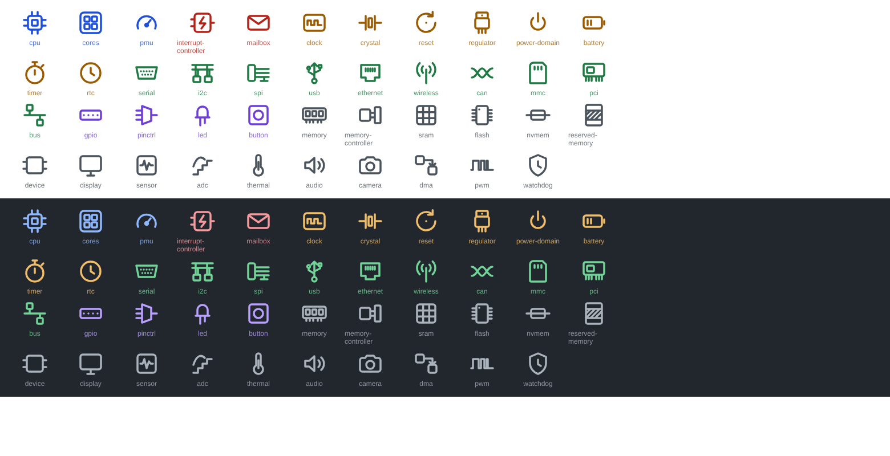

# Device icons

Original icons for the element library and canvas nodes, kept aside for a
future story. Nothing here is wired into the app yet.

| Path | Content |
| --- | --- |
| `icons/` | 43 icons, one per kind of device in the kernel's binding schemas. |
| `icons.json` | The same shapes as path data, with each icon's binding directories and the kind colors. |
| `build.mjs` | Source of truth: edit the shapes there, then run `node design/devices/build.mjs`. |

## Categories

The icons use the seven node kinds of US-15.6 (`app/src/categories.ts`)
and the chip colors of `docs/workbench.md`:

| Kind | Icons |
| --- | --- |
| `cpu` | cpu, cores, pmu |
| `irq` | interrupt-controller, mailbox |
| `clock` | clock, crystal, reset, regulator, power-domain, battery, timer, rtc |
| `bus` | serial, i2c, spi, usb, ethernet, wireless, can, mmc, pci, bus |
| `gpio` | gpio, pinctrl, led, button |
| `mem` | memory, memory-controller, sram, flash, nvmem, reserved-memory |
| `other` | device, display, sensor, adc, thermal, audio, camera, dma, pwm, watchdog |

Each icon in `icons.json` lists the binding directories it is meant for
(`categories`), a finer mapping than the kind for the library's sections
(US-18.2).

## Icons

24 px grid, 1.75 px stroke, round caps and joins, `currentColor`: the same
grammar as the Lucide icons of the workbench, so they can sit side by side.
Each icon is a single `<path>`.

The design canvas with the icon sheet is kept by the maintainer.
