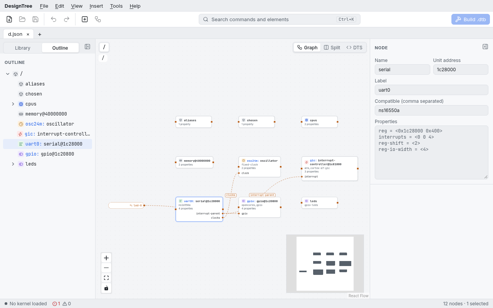

# The window

- **Menu bar** at the top: File, Edit, View, Insert, Arrange, Tools and Help hold
  every command, each with its shortcut; greyed-out items cannot run right
  now (no selection, say). Alt and the underlined letter opens a menu, the
  arrow keys move through it.
- **Toolbar** under it: New, Open and Save; Undo and Redo; Add empty node and
  Tidy this canvas; the command search (Ctrl+K); and **Build .dtb** on the right.
  Hover a button for its name and shortcut.
- **Tabs** hold the open designs. A dot marks unsaved changes; closing a tab
  or the window with unsaved changes asks first.
- **Activity bar** (left edge): one button per side bar view, Library and
  Outline, and Settings at the bottom. Click a view to show it; click the
  view on show to collapse the side bar.
- **Side bar** (left), with two views:
  - **Library** (Ctrl+Shift+E): the elements of the loaded kernel checkout, with search,
    categories, favorites and recent elements.
  - **Outline** (Ctrl+Shift+O): the whole devicetree as a tree. Click a node
    to select it on the canvas, among its siblings, and in the source,
    wherever it is (a click on the node whose scope is open goes back up to
    its parent's scope); double-click
    it, or press Enter, to open its scope. The arrow keys move through the
    tree and open or close branches, and the tree opens down to whatever you
    select elsewhere.
    The filter field at the top keeps the nodes whose name, label,
    compatible or phandle holds what you type (or their path, for text with
    a slash, such as `/soc/i2c`), with the nodes above
    them (in grey) so you see where they are; Enter shows the first match in
    its scope, the Down arrow moves into the tree, and Escape clears it.
  - **Go to node** (Ctrl+P, View menu) finds a node anywhere in the design the
    same way, from the keyboard: names and labels that are what you typed
    come first, then the ones that start with it. Enter shows the node in its
    scope and selects it.
- **Canvas** (middle): the devicetree as a graph. A tinted icon on each node
  and library row shows its kind: CPU, interrupt controller, clock, bus or
  serial device, GPIO, memory. Zoom with the mouse wheel
  or the buttons at the bottom left; the minimap at the bottom right shows
  where you are.
- **Inspector** (right, top): the selected node, reference or group.
- **DTS source**: the devicetree source of the design, editable, kept in
  sync with the canvas. The switch at the top right of the editor shows the
  graph, the graph and the source side by side, or the source alone
  (Ctrl+1, Ctrl+2, Ctrl+3, also in **View**). Each tab keeps its own mode;
  new tabs start in the last one chosen. In Split mode, drag the line between the
  graph and the source to give either more room (or focus it with Tab and
  use the arrow keys); double-click it for an even split. The split is
  remembered.
- **Bottom panel** (under the canvas, Ctrl+J): **Problems** (structural
  errors and the schema check), **Build** (dtc's output), **Interrupts** and
  **Address map**. A build opens it on Build.
- **Status bar**: a button that opens and closes the bottom panel, the
  loaded kernel, the dtc version and the error and warning counts. Click
  one to go to its settings or to the problems.

## Arranging the panes

Drag the edge of the library, the inspector or the bottom panel to resize it;
double-click the edge for its default size, or focus it with Tab and use the
arrow keys. The activity bar collapses and brings back the side bar; the
button in the inspector's corner collapses it to a narrow rail, whose button
brings it back; the button at the left of the status bar opens and closes
the bottom panel. **View** has the same toggles, with Ctrl+Shift+E (library),
Ctrl+Shift+O (outline), Ctrl+Shift+I (inspector) and Ctrl+J (bottom panel).
Sizes and which panes are open are remembered.

To open a design at start, pass its path: `designtree-app board.json`.
