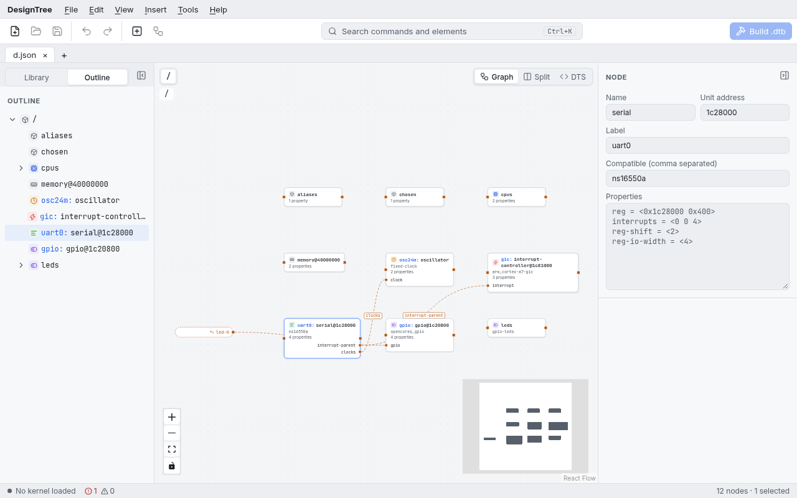

# The window

- **Menu bar** at the top: File, Edit, View, Insert, Tools and Help hold
  every command, each with its shortcut; greyed-out items cannot run right
  now (no selection, say). Alt and the underlined letter opens a menu, the
  arrow keys move through it.
- **Toolbar** under it: New, Open and Save; Undo and Redo; Add empty node and
  Auto layout; the command search (Ctrl+K); and **Build .dtb** on the right.
  Hover a button for its name and shortcut.
- **Tabs** hold the open designs. A dot marks unsaved changes; closing a tab
  or the window with unsaved changes asks first.
- **Library** (left): the elements of the loaded kernel checkout, with
  search, categories, favorites and recent elements.
- **Canvas** (middle): the devicetree as a graph. Zoom with the mouse wheel
  or the buttons at the bottom left; the minimap at the bottom right shows
  where you are.
- **Inspector** (right, top): the selected node, reference or group.
- **DTS source** (right, under the inspector): the devicetree source of the
  design, editable, kept in sync with the canvas.
- **Bottom panel** (under the canvas, Ctrl+J): **Problems** (structural
  errors and the schema check), **Build** (dtc's output), **Interrupts** and
  **Address map**. A build opens it on Build.
- **Status bar**: the loaded kernel, the dtc version and the error and
  warning counts. Click one to go to its settings or to the problems.

## Arranging the panes

Drag the edge of the library, the inspector or the bottom panel to resize it;
double-click the edge for its default size, or focus it with Tab and use the
arrow keys. The button in a pane's corner collapses it to a narrow rail, and
the rail's button brings it back; **View** has the same toggles, with
Ctrl+Shift+L (library), Ctrl+Shift+I (inspector) and Ctrl+J (bottom panel).
Sizes and which panes are open are remembered.

To open a design at start, pass its path: `designtree-app board.json`.
